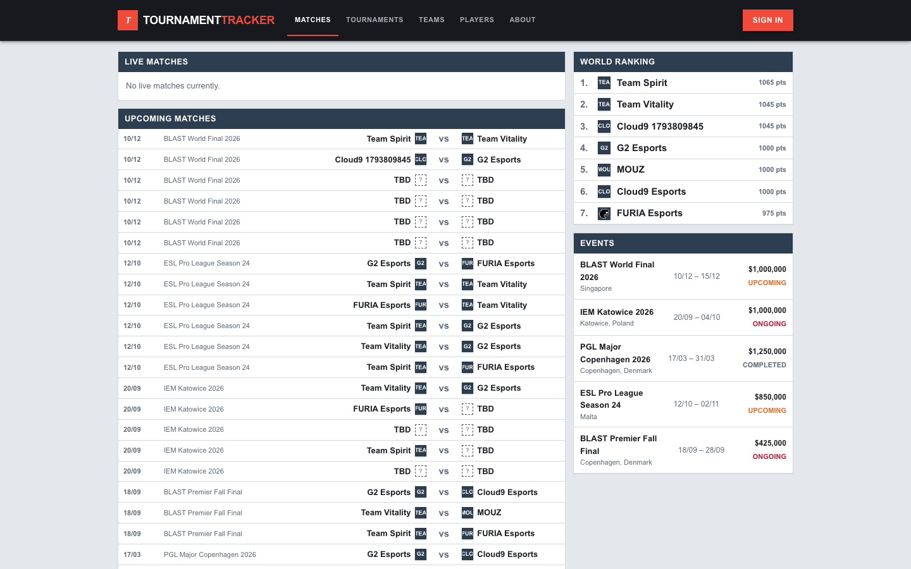
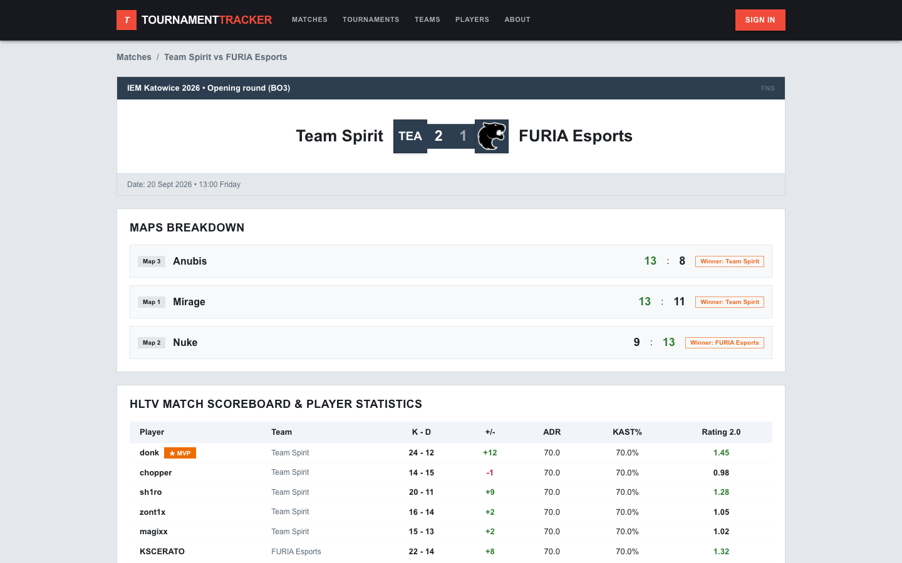
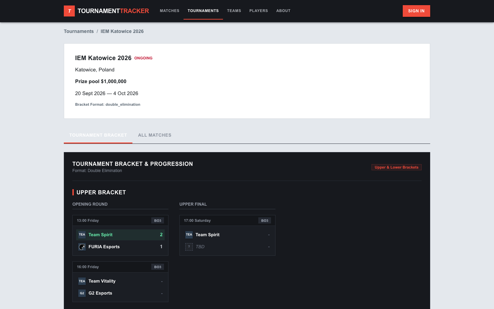
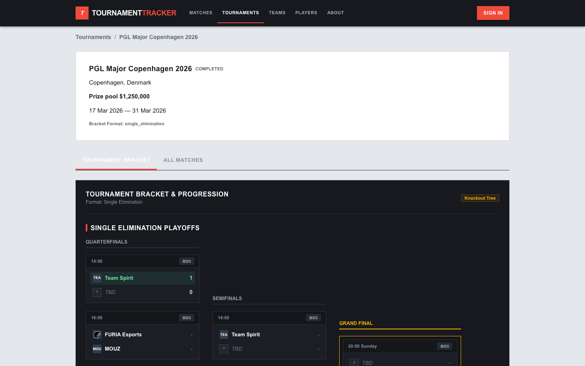
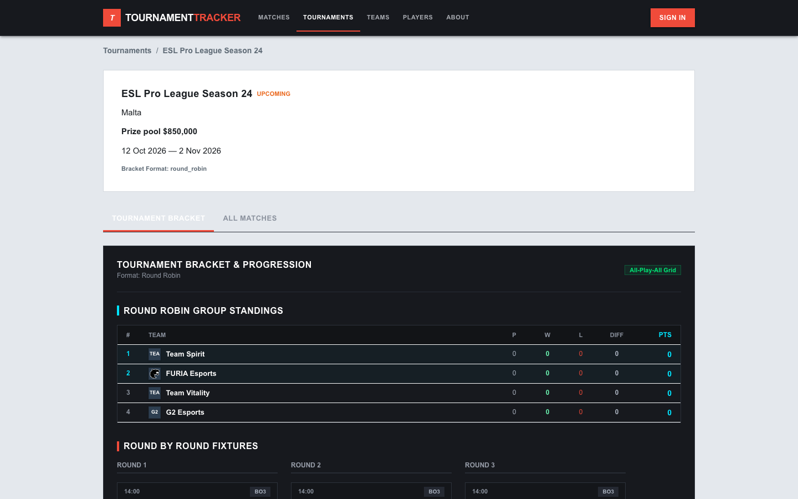
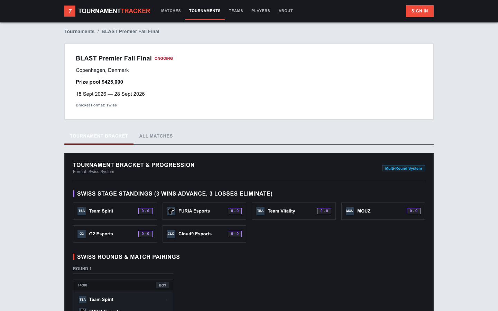
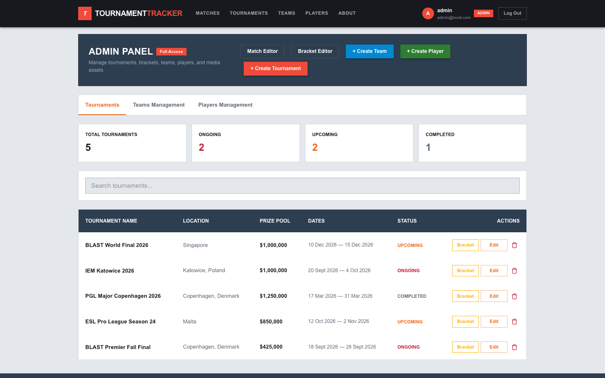
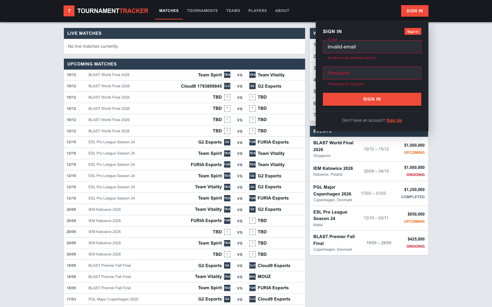
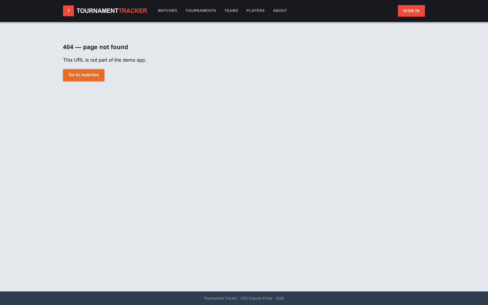

# Tournament Tracker

Веб-приложение для отслеживания киберспортивных турниров, турнирных сеток различных форматов, команд, игроков, матчей и детальной статистики по картам (HLTV-style).

Проект разработан в рамках курса Fullstack-разработки (Лабораторные работы №1–5: Backend, API, База данных, Аутентификация, Ролевая модель, Турнирные сетки и Интеграция Frontend/Backend).

---

## Скриншоты интерфейса

### 1. Главная страница со списком турниров и матчей


### 2. Детальная страница матча с картами и HLTV-статистикой игроков


### 3. Турнир с сеткой Double Elimination (Upper, Lower, Grand Final)


### 4. Турнир с сеткой Single Elimination (2–32 команд, авто-посев и BYE)


### 5. Турнир с круговой таблицей Round Robin


### 6. Турнир со Swiss-системой (сведение участников по победам)


### 7. Панель управления администратора


### 8. Форма входа и клиентская валидация


### 9. Защита маршрутов: 404 при попытке гостя открыть /admin


---

## Стек технологий

- **Backend**: Python 3.11+, [FastAPI](https://fastapi.tiangolo.com/), [SQLAlchemy 2.0](https://www.sqlalchemy.org/), [Pydantic v2](https://docs.pydantic.dev/), [Alembic](https://alembic.sqlalchemy.org/), Uvicorn
- **База данных**: [PostgreSQL 16](https://www.postgresql.org/) (драйвер `psycopg3`), [SQLite](https://www.sqlite.org/) (для легковесного локального тестирования и CI с `PRAGMA foreign_keys=ON;`)
- **Безопасность и аутентификация**:
  - Хеширование паролей: **Argon2id** (`argon2-cffi`) в соответствии с рекомендациями OWASP.
  - Двухтокеновая авторизация: **JWT Access Token** (HS256 через PyJWT с обязательной проверкой подписи, срок 30 мин) + **Refresh Token** (UUID, срок 7 дней, хранение SHA-256 хеша в PostgreSQL, ротация токенов и защита семейств токенов от replay-атак).
  - Строгая ролевая модель: админ-доступ определяется **исключительно** полем `User.is_admin` из базы данных. Единственный системный администратор создаётся идемпотентно при старте приложения из переменных `ADMIN_EMAIL` / `ADMIN_PASSWORD`.
  - Безопасная загрузка файлов: проверка magic bytes через Pillow (PNG, JPEG, WEBP; SVG исключён во избежание XSS). Лимит загрузки `client_max_body_size 8m;` в Nginx.
- **Контейнеризация**: Docker (непривилегированный пользователь `appuser`), Docker Compose с healthcheck и именованными томами `pgdata` и `uploads_data`.
- **Frontend**: [React 19](https://react.dev/), [TypeScript 6](https://www.typescriptlang.org/), [Vite 8](https://vitejs.dev/), [Material UI (MUI v9)](https://mui.com/), `@emotion/react`, `@emotion/styled`, [React Router v7](https://reactrouter.com/), [Oxlint](https://oxc.rs/)

---

## Реализованные лабораторные работы

### Лабораторная работа №4: Аутентификация, безопасность и ролевая модель
1. **Стойкое хеширование паролей**: Argon2id с уникальной солью на пользователя, проверка стойкости и защита от подбора.
2. **Двухтокеновая схема и ротация токенов**:
   - `POST /api/auth/login` выдаёт пару токенов: `access_token` (JWT HS256, 30 минут) и `refresh_token` (криптостойкий UUID, 7 дней).
   - В базе данных сохраняется только `token_hash = sha256(raw_refresh_token)`. Сырой токен не хранится на сервере.
   - `POST /api/auth/refresh` выполняет **ротацию токенов**: старый токен отзывается, выдаётся новая пара `access_token` и `refresh_token` в рамках одной `token_family`.
   - **Защита от Replay-атак**: при попытке повторного использования уже отозванного refresh-токена сервер немедленно отзывает ВСЕ токены данного семейства (`token_family`), принудительно разлогинивая скомпрометированную сессию.
   - `POST /api/auth/logout` публично доступен: принимает refresh-токен в теле запроса (или access-токен в заголовке), отзывает его в базе и очищает клиентское состояние.
3. **Строгая ролевая модель администратора**:
   - Единственный администратор создаётся идемпотентно при старте: `admin@local.com` / `admin` (настраивается через `ADMIN_EMAIL` и `ADMIN_PASSWORD`).
   - Файловый механизм списков администраторов полностью удален. Админство определяется только полем `User.is_admin == True` в базе данных.
   - Любая регистрация пользователя (`POST /api/auth/register`) создаёт строго не-админа (`is_admin=False`).
   - Неавторизованные пользователи или гости при попытке перехода на `/admin` получают стандартную страницу 404 (NotFoundPage), не раскрывая существования админки.
   - Все подсказки, демонстрационные пароли и чипсы тестовых аккаунтов удалены из интерфейса.
   - `PATCH /api/auth/me` блокирует изменение email, исключая возможность эскалации привилегий.

### Лабораторная работа №5: Турнирные сетки, статистика и интеграция Frontend/Backend
1. **Единый источник истины и API-клиент**:
   - Полное подключение всех экранов frontend к реальному FastAPI backend без скрытых моков и fallback-заглушек.
   - Автоматический интерцептор перехвата 401 ошибки с прозрачным обновлением токенов (refresh token rotation) и очередью запросов (`client.ts`).
2. **Универсальная генерация турнирных сеток**:
   - **Single Elimination ($N = 2..32$)**: турнирная сетка с классическим киберспортивным посевом (`[1, S, S/2, S/2+1, ...]`) и автоматическим прохождением BYE-раундов для семян $1..2^{\lceil \log_2 N \rceil} - N$.
   - **Double Elimination ($N = 4$ или $N = 8$)**: верхняя сетка (Upper Bracket), нижняя сетка (Lower Bracket) с автоматическим падением проигравших и Гранд-финал. Попытка создания DE-сетки для невалидного числа участников отклоняется с кодом 400.
   - **Round Robin**: круговой турнир по алгоритму Бергера (каждый играет с каждым ровно один раз).
   - **Swiss System**: швейцарская система раундов со сведением участников по очкам (`POST /api/tournaments/{id}/bracket/next-round`) без повторных пар и автоматической добивкой при нечётном числе участников.
3. **HLTV-статистика матчей**:
   - Модели `MapResult` (Mirage, Inferno, Nuke, Dust2, Anubis) и `PlayerMatchStat` (Kills, Deaths, Assists, ADR, KAST%, MVP, Rating 2.0).
   - Автоматический расчёт рейтинга игрока по картам по формуле HLTV Rating 2.0.
   - Оптимизированные запросы с устранением проблемы N+1 (`joinedload` / SQL aggregation).
4. **Миграции Alembic и стабильность**:
   - Полная схема базы данных зафиксирована в ревизии Alembic (`c124b0bf8faf_initial_schema.py`).
   - Автоматическое применение миграций при старте контейнера (`docker-entrypoint.sh`).
   - Обработка внутренних ошибок 500: маскирование отладочной информации в production (`settings.DEBUG == False`).
5. **Оптимизация фронтенда**:
   - Разделение бандла на чанки с нативным React Router `lazy`: размер основного бандла ~37 kB (gzip ~10.4 kB), вендоры MUI и React вынесены в отдельные чанки.
   - Oxlint линтинг: 0 ошибок и 0 предупреждений.

---

## Архитектура проекта

```text
tournamenttracker/
├── backend/
│   ├── alembic/              # Миграции базы данных Alembic
│   │   ├── versions/         # c124b0bf8faf_initial_schema.py
│   │   └── env.py
│   ├── app/
│   │   ├── config.py         # Настройки, Pydantic Settings, переменные окружения
│   │   ├── auth.py           # Argon2id, JWT HS256, RefreshToken (SHA-256 hash, family rotation)
│   │   ├── database.py       # SQLAlchemy engine, session maker, SQLite FK listener
│   │   ├── models.py         # 9 моделей: User, RefreshToken, Tournament, Bracket, Match, MapResult, PlayerMatchStat, Team, Player
│   │   ├── schemas.py        # Pydantic v2 схемы с Literal, валидацией дат и URL
│   │   ├── crud.py           # Single/Double/RoundRobin/Swiss алгоритмы, HLTV Rating 2.0, Pillow-валидация
│   │   ├── seed.py           # Демо-данные CS2 команд (Spirit, Vitality, G2, MOUZ, FURIA, Cloud9)
│   │   ├── cli.py            # CLI-команды: purge-users, create-admin
│   │   ├── main.py           # FastAPI app, CORS, глобальный обработчик 500, lifespan
│   │   └── routers/          # auth, admin, tournaments, matches, teams, players, leaderboards
│   ├── tests/                # 40 интеграционных тестов с изолированным SQLite TestClient
│   │   ├── conftest.py
│   │   ├── test_all_38_swagger_routes.py
│   │   ├── test_api.py
│   │   ├── test_audit.py
│   │   ├── test_crud.py
│   │   ├── test_lab4_security_and_auth.py
│   │   ├── test_lab5_brackets_and_stats.py
│   │   └── test_swagger_endpoints.py
│   ├── docker-entrypoint.sh  # Ожидание PostgreSQL и автоматический alembic upgrade head
│   ├── requirements.txt      # Продакшн-зависимости (FastAPI, SQLAlchemy, PyJWT, Pillow, Argon2)
│   └── Dockerfile            # Multi-stage production Dockerfile (non-root appuser)
│
├── frontend/
│   ├── src/
│   │   ├── app/              # Провайдеры (AuthProvider, TournamentProvider), маршрутизация
│   │   ├── components/       # Header, MatchRow, RankingBox, StatusChips
│   │   ├── features/         # Визуализаторы сеток, управление командами/игроками/турнирами/медиа
│   │   ├── pages/            # HomePage, MatchPage, TournamentPage, AdminPage, NotFoundPage
│   │   ├── router/           # React Router v7 с lazy-загрузкой
│   │   ├── shared/           # API-клиент (client.ts), валидация, TeamLogo, PlayerAvatar
│   │   └── types/            # TypeScript контракты API и моделей
│   ├── nginx.conf            # SPA Nginx с client_max_body_size 8m; и реверс-прокси к /api/
│   ├── package.json
│   └── Dockerfile
│
├── scripts/
│   └── capture_screenshots.py# Скрипт Playwright для снятия реальных скриншотов всех страниц
├── docs/
│   └── screenshots/          # Скриншоты реальной работы интерфейса
├── docker-compose.yml        # Оркестрация: PostgreSQL 16 + FastAPI + Nginx Frontend
└── README.md
```

---

## Запуск приложения

### 1. Запуск через Docker Compose (рекомендуется)

```bash
# Клонирование и запуск всех сервисов
docker compose up -d --build

# Проверка статуса контейнеров (все должны быть Up/healthy)
docker compose ps
```

Сервисы будут доступны по адресам:
- **Frontend SPA**: `http://localhost:5173`
- **Backend API**: `http://localhost:8000`
- **Интерактивная документация Swagger**: `http://localhost:8000/docs`

Учётная запись администратора:
- **Email**: `admin@local.com` (настраивается через `ADMIN_EMAIL`)
- **Пароль**: `admin` (настраивается через `ADMIN_PASSWORD`)

#### Управление базой данных и пользователями
- Для полной переинициализации базы данных с нуля:
  ```bash
  docker compose down -v
  docker compose up -d --build
  ```
- Для очистки пользователей без удаления турниров и команд:
  ```bash
  docker compose exec backend python -m app.cli purge-users
  # или локально:
  python3 -m app.cli purge-users
  ```
- Для создания дополнительного администратора через CLI:
  ```bash
  docker compose exec backend python -m app.cli create-admin newadmin@local.com anotherAdminPass2026
  ```

---

### 2. Локальный запуск без Docker

#### Backend
```bash
cd backend

# Создание виртуального окружения
python3 -m venv venv
source venv/bin/activate

# Установка зависимостей
pip install -r requirements.txt
pip install -r requirements-dev.txt

# Настройка переменных окружения
cp ../.env.example ../.env

# Применение миграций Alembic
alembic upgrade head

# Запуск сервера разработки
uvicorn app.main:app --reload --host 0.0.0.0 --port 8000
```

#### Frontend
```bash
cd frontend

# Установка зависимостей
npm install

# Запуск dev-сервера с HMR
npm run dev
```

---

## Тестирование и верификация

### Запуск тестов бэкенда (pytest)
Все 40 тестов выполняются в изолированном окружении SQLite с включенными внешними ключами и не требуют запущенных внешних баз данных:

```bash
# Из корня проекта
python3 -m pytest backend/tests -v
```

Результат:
```text
============================== 40 passed in 4.42s ==============================
```

### Проверка типов, сборка и линтинг фронтенда
```bash
cd frontend

# Линтинг кода (Oxlint)
npm run lint

# Компиляция TypeScript и production-сборка Vite
npm run build
```

Результат:
```text
Found 0 warnings and 0 errors.
Finished in 78ms on 66 files with 117 rules.
✓ built in 184ms (main bundle ~37 kB, vendor chunks separated)
```

---

## Конфигурационные переменные (.env)

| Переменная | Назначение | Значение по умолчанию |
|---|---|---|
| `DATABASE_URL` | Строка подключения к PostgreSQL | `postgresql+psycopg://tracker:tracker@db:5432/tracker` |
| `SECRET_KEY` | Секретный ключ для подписи JWT | Обязательная переменная в production |
| `ADMIN_EMAIL` | Email системного администратора | `admin@local.com` |
| `ADMIN_PASSWORD` | Пароль системного администратора | `admin` |
| `AUTO_SEED` | Автоматическое наполнение демо-данными | `true` |
| `ACCESS_TOKEN_EXPIRE_MINUTES`| Время жизни Access Token | `30` |
| `REFRESH_TOKEN_EXPIRE_DAYS` | Время жизни Refresh Token | `7` |
| `ALLOWED_ORIGINS` | Белый список разрешённых CORS-источников | `http://localhost:5173,http://127.0.0.1:5173` |
