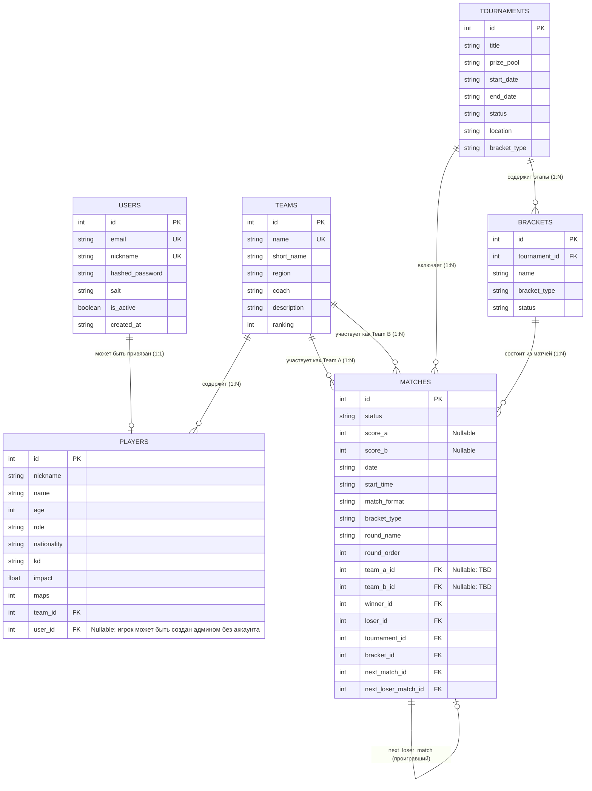

# Tournament Tracker

Веб-приложение для отслеживания киберспортивных турниров, сеток соревнований, команд, игроков, матчей и управления аккаунтами.

Проект разработан в рамках курса Fullstack-разработки (Лабораторные работы №2–3: Backend, API, База данных, Аутентификация, Ролевая модель и Турнирные сетки).

---

## Стек технологий

- **Backend**: Python 3.11+, [FastAPI](https://fastapi.tiangolo.com/), [SQLAlchemy 2.0](https://www.sqlalchemy.org/), [Pydantic v2](https://docs.pydantic.dev/), Uvicorn
- **База данных**: [PostgreSQL 16](https://www.postgresql.org/), драйвер `psycopg3`
- **Безопасность**: PBKDF2-HMAC-SHA256 (хеширование паролей), HMAC-SHA256 Bearer Tokens
- **Контейнеризация**: Docker, Docker Compose
- **Frontend**: React, TypeScript, Vite, Tailwind CSS, Nginx

---

## Архитектура backend-приложения

Код серверной части разделен по слоям ответственности:

```text
backend/
├── app/
│   ├── config.py         # Конфигурация приложения и чтение переменных окружения (.env)
│   ├── auth.py           # Хеширование паролей, Bearer-токены, динамическое чтение admins.txt
│   ├── database.py       # Подключение к PostgreSQL, фабрика сессий SessionLocal, get_db
│   ├── models.py         # Модели SQLAlchemy (таблицы, связи, ON DELETE CASCADE, TBD слоты)
│   ├── schemas.py        # Схемы валидации Pydantic (User, Admin, Bracket, Match, Team, Player)
│   ├── crud.py           # Доступ к данным, продвижение по сетке (advance), генераторы сеток
│   ├── seed.py           # Автоматическое наполнение базы демонстрационными данными и сетками
│   ├── main.py           # Точка входа FastAPI, CORS, регистрация роутеров и lifespan
│   └── routers/          # Маршруты API:
│       ├── auth.py       # Регистрация, логин, профиль текущего пользователя (/api/auth)
│       ├── admin.py      # Админ-панель: пользователи, управление игроками (/api/admin)
│       ├── tournaments.py# Турниры и генерация сеток (/api/tournaments)
│       ├── matches.py    # Матчи и обновление счетов (/api/matches)
│       ├── teams.py      # Команды (/api/teams)
│       ├── players.py    # Профили игроков (/api/players)
│       └── leaderboards.py# Таблицы лидеров
├── tests/                # Автоматические тесты (авторизация, админка, сетки, CRUD)
│   ├── conftest.py
│   ├── test_api.py
│   └── test_crud.py
├── admins.txt            # Список учетных записей администраторов (динамическое чтение)
├── Dockerfile            # Контейнеризация бэкенда
└── requirements.txt      # Зависимости Python
```

---

## Модель данных (Entity-Relationship)

### ER-диаграмма связей



---

## Турнирные сетки (Bracket System)

Поддерживаются 4 типа турнирных сеток с автоматическим формированием графа матчей:

1. **`double_elimination` (Двойное выбывание / Double Elimination)**:
   - **Upper Bracket (Сетка виннеров)**: Opening round $\rightarrow$ Upper final.
   - **Lower Bracket (Сетка лузеров)**: Lower final $\rightarrow$ Consolidation final.
   - **Grand Final (Гранд-финал)**: победитель виннеров против победителя Consolidation final.
   - *Авто-продвижение*: при завершении матча (`status: FINISHED`) победитель автоматически переходит в `next_match_id`, а проигравший падает в `next_loser_match_id`.

2. **`single_elimination` (Олимпийская сетка на выбывание)**:
   - Полуфиналы $\rightarrow$ Финал. Проигравший выбывает, победитель продвигается дальше.

3. **`round_robin` (Круговая система / каждый с каждым)**:
   - Генерирует полное расписание туров, где каждая команда играет против каждой.

4. **`swiss` (Швейцарская система)**:
   - Стартовый посев туров с последующим распределением по очкам.

---

## Аккаунты, роли и админ-панель

### 1. Файл администраторов (`admins.txt`)
Права администратора определяются файлом [`admins.txt`](file:///Users/nikitapahomov/fullstack/tournamenttracker/admins.txt) в корне репозитория (и `backend/admins.txt`).
- Файл считывается **динамически в реальном времени**: добавление или удаление email из файла моментально меняет привилегии пользователя без перезапуска сервера!
- Пример содержимого:
  ```text
  admin@tracker.local
  organizer@tracker.local
  ```

### 2. Права обычного пользователя:
- Обычный зарегистрированный пользователь **не имеет прав** на создание и редактирование турниров, команд, матчей или чужих профилей.
- В своём профиле (`PATCH /api/auth/me`) обычный пользователь может изменять **только**:
  - `email` (почту)
  - `nickname` (никнейм)
  - `password` (пароль)
- Игровые и статистические данные (K/D, Impact, команду, рейтинг) обычный пользователь менять не может — их заполняет только администратор.

### 3. Возможности администратора:
- Создание, редактирование и удаление турниров (`POST /api/tournaments`, `PATCH`, `DELETE`).
- Выбор и генерация сеток любого типа (`POST /api/tournaments/{id}/bracket/generate`).
- Управление матчами, выставление счетов с авто-продвижением победителей по сетке.
- **Управление игроками**:
  - Создание игрока **без почты и пароля** (`user_id = None`), чтобы сразу добавить в турнир.
  - Привязка зарегистрированного пользователя к профилю игрока (`POST /api/admin/players/claim`).
  - Просмотр всех пользователей системы (`GET /api/admin/users`).

---

## Демонстрационные учетные записи (Seed)

При первом старте база автоматически наполняется пользователями:

| Email | Пароль | Роль | Описание |
|---|---|---|---|
| `admin@tracker.local` | `password123` | **Администратор** | Указан в `admins.txt`, полный доступ к админке и турнирам |
| `user@tracker.local` | `password123` | **Пользователь** | Обычный аккаунт, привязан к игроку *donk* |

---

## Запуск проекта

### 1. Запуск через Docker Compose

```bash
docker compose up --build
```
- **Backend API**: [http://localhost:8000](http://localhost:8000)
- **Swagger UI**: [http://localhost:8000/docs](http://localhost:8000/docs)
- **Frontend**: [http://localhost:5173](http://localhost:5173)
- **PostgreSQL**: `localhost:5432`

### 2. Локальный запуск бэкенда

```bash
python3 -m venv .venv
source .venv/bin/activate
pip install -r backend/requirements.txt
cd backend
uvicorn app.main:app --reload --host 0.0.0.0 --port 8000
```

### 3. Запуск тестов

```bash
python3 backend/tests/test_crud.py
```
